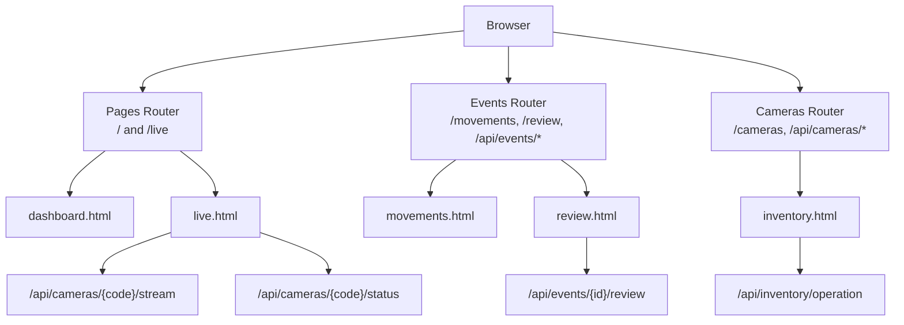
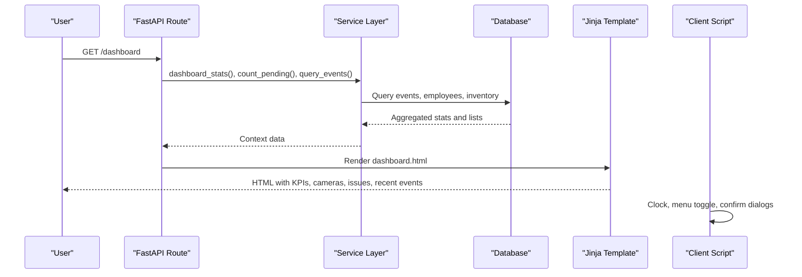
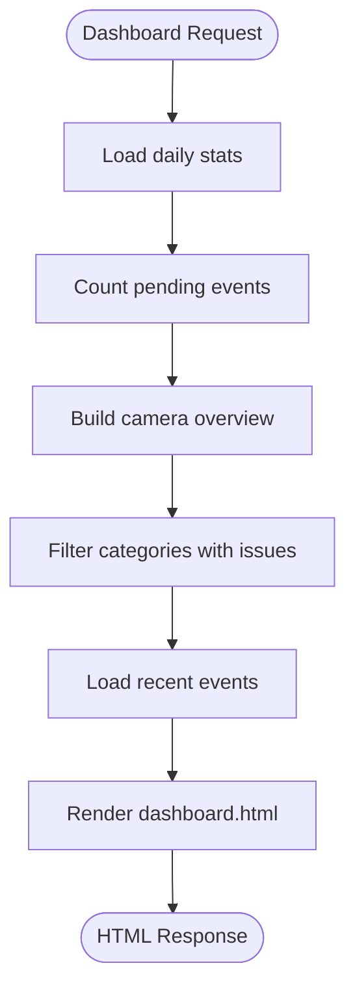
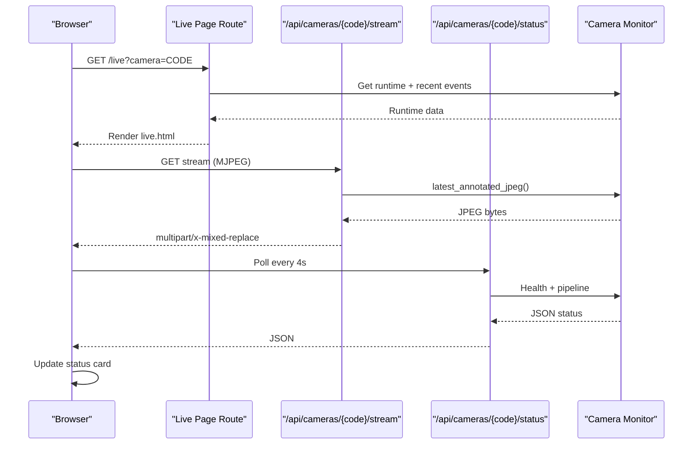
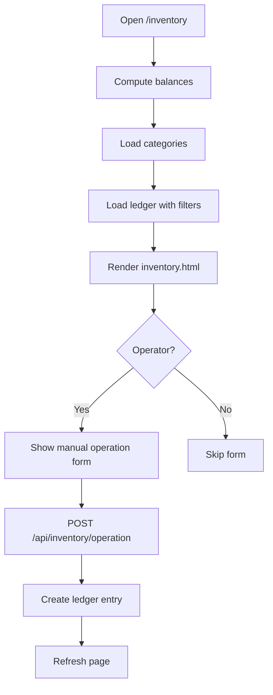
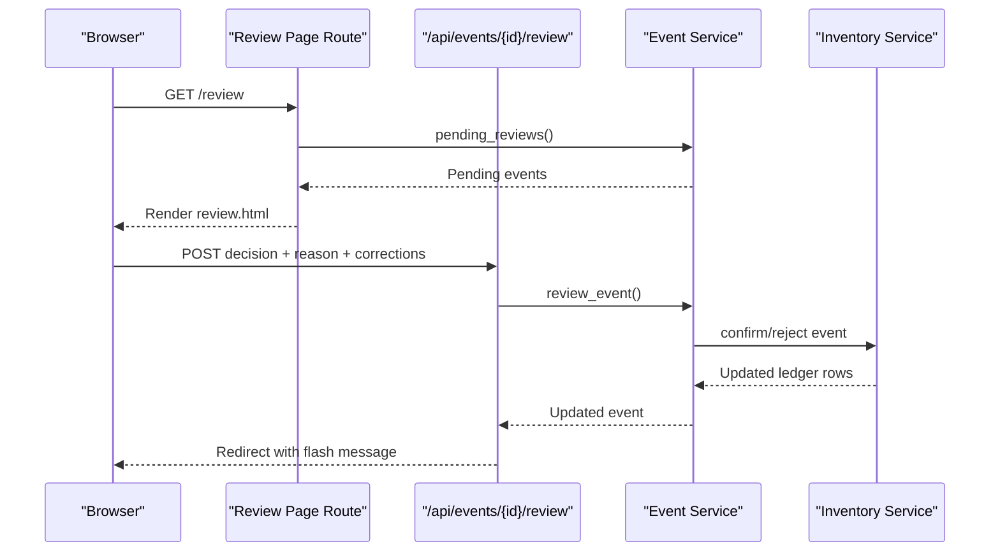
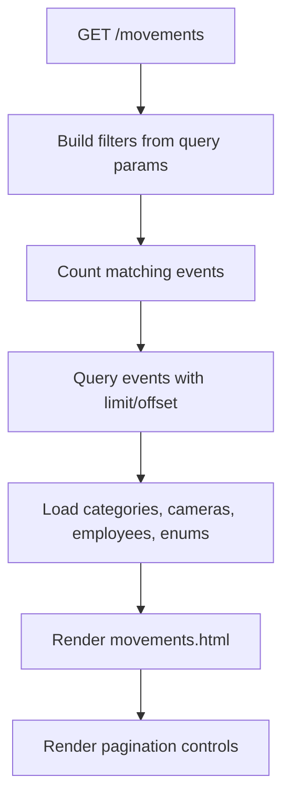
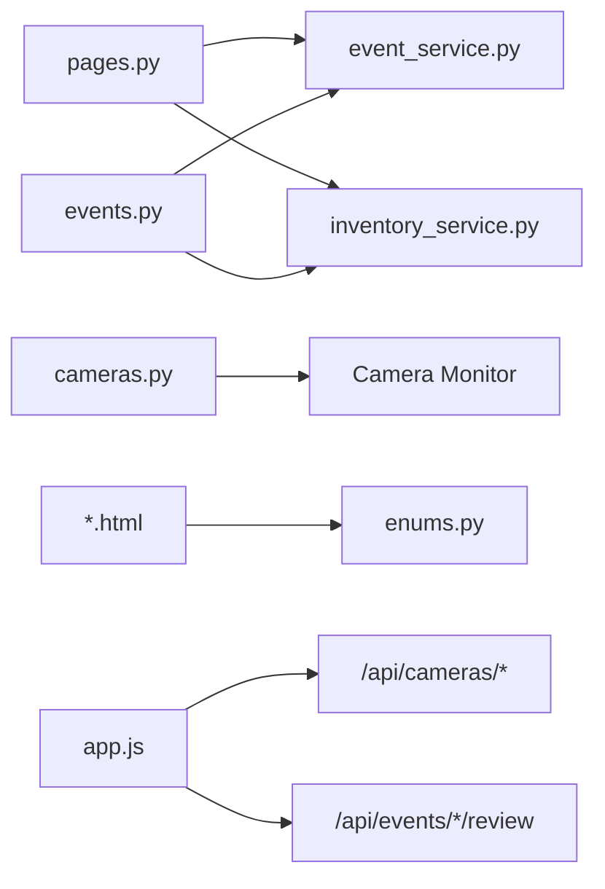

# Page Components & Views

<cite>
**Referenced Files in This Document**
- [main.py](file://app/main.py)
- [pages.py](file://app/api/pages.py)
- [events.py](file://app/api/events.py)
- [cameras.py](file://app/api/cameras.py)
- [event_service.py](file://app/services/event_service.py)
- [inventory_service.py](file://app/services/inventory_service.py)
- [enums.py](file://app/models/enums.py)
- [dashboard.html](file://app/ui/templates/dashboard.html)
- [live.html](file://app/ui/templates/live.html)
- [inventory.html](file://app/ui/templates/inventory.html)
- [review.html](file://app/ui/templates/review.html)
- [movements.html](file://app/ui/templates/movements.html)
- [app.js](file://app/ui/static/app.js)
</cite>

## Table of Contents
1. [Introduction](#introduction)
2. [Project Structure](#project-structure)
3. [Core Components](#core-components)
4. [Architecture Overview](#architecture-overview)
5. [Detailed Component Analysis](#detailed-component-analysis)
6. [Dependency Analysis](#dependency-analysis)
7. [Performance Considerations](#performance-considerations)
8. [Troubleshooting Guide](#troubleshooting-guide)
9. [Conclusion](#conclusion)

## Introduction
This document explains the individual page components and their specific functionality: dashboard overview, live camera view with MJPEG streaming, inventory management interface, review workflow for pending events, and movements tracking display. It also documents how server-rendered templates bind to client-side JavaScript enhancements, form handling patterns, real-time updates, conditional rendering, and integration with backend APIs.

The application is a FastAPI-based system where HTML templates are rendered by the server and enhanced by a small client-side script that handles UI interactions, MJPEG stream recovery, periodic status polling, and form behavior.

## Project Structure
The relevant pages are implemented as:
- Server routes that render Jinja templates and pass context data.
- Templates that use conditional logic, filters, and links to API endpoints.
- A shared client-side script that enhances forms, streams, and status cards.

**Diagram sources**
- [pages.py:25-78](file://app/api/pages.py#L25-L78)
- [events.py:40-88](file://app/api/events.py#L40-L88)
- [cameras.py:100-103](file://app/api/cameras.py#L100-L103)
- [dashboard.html:1-188](file://app/ui/templates/dashboard.html#L1-L188)
- [live.html:1-158](file://app/ui/templates/live.html#L1-L158)
- [movements.html:1-171](file://app/ui/templates/movements.html#L1-L171)
- [review.html:1-144](file://app/ui/templates/review.html#L1-L144)
- [inventory.html:1-200](file://app/ui/templates/inventory.html#L1-L200)

**Section sources**
- [main.py:44-68](file://app/main.py#L44-L68)
- [pages.py:25-78](file://app/api/pages.py#L25-L78)

## Core Components
- Dashboard overview: KPIs for entries/exits, unknown persons, equipment movement, pending reviews; camera table; system health; recent events.
- Live camera view: Camera selection, MJPEG stream image tag, status panel, recent events per camera.
- Inventory management: Category balances, pending totals, manual operation form, ledger table with filters.
- Review workflow: Pending events list with evidence images, decision buttons, employee/category/asset correction fields.
- Movements tracking: Filterable paginated event history with confidence scores, direction badges, evidence links.

**Section sources**
- [dashboard.html:5-26](file://app/ui/templates/dashboard.html#L5-L26)
- [live.html:5-43](file://app/ui/templates/live.html#L5-L43)
- [inventory.html:5-28](file://app/ui/templates/inventory.html#L5-L28)
- [review.html:5-15](file://app/ui/templates/review.html#L5-L15)
- [movements.html:5-11](file://app/ui/templates/movements.html#L5-L11)

## Architecture Overview
The pages follow a consistent pattern:
- A route handler loads data from services and renders a template with context variables.
- The template uses Jinja conditionals and filters to render KPIs, tables, and forms.
- Client-side JavaScript adds interactivity without replacing server-rendered content.

**Diagram sources**
- [pages.py:25-56](file://app/api/pages.py#L25-L56)
- [event_service.py:304-324](file://app/services/event_service.py#L304-L324)
- [dashboard.html:5-188](file://app/ui/templates/dashboard.html#L5-L188)
- [app.js:1-34](file://app/ui/static/app.js#L1-L34)

## Detailed Component Analysis

### Dashboard Overview
Purpose:
- Show daily statistics (entries, exits, unknown persons, equipment in/out).
- Summarize camera online/offline counts and worker status.
- Highlight inventory discrepancies.
- Display system health indicators and recent events.

Data binding:
- `stats.entries`, `stats.exits`, `stats.unknown_persons`, `stats.equipment_in`, `stats.equipment_out` come from service aggregation.
- `pending_total` is the count of pending events.
- `cameras` rows include runtime status and frame counters.
- `issues` are categories with pending out or discrepancy.
- `recent_events` shows last events with type labels and timestamps.

Conditional rendering examples:
- Unknown person badge class changes based on presence.
- Camera status badge depends on enum value.
- System health badges reflect monitor, YOLO, face recognition, Google Sheets configuration.

Integration points:
- Routes call `event_service.dashboard_stats`, `event_service.count_pending`, `event_service.query_events`.
- Camera overview merges database rows with runtime state.

**Diagram sources**
- [pages.py:25-56](file://app/api/pages.py#L25-L56)
- [event_service.py:304-324](file://app/services/event_service.py#L304-L324)
- [cameras.py:28-47](file://app/api/cameras.py#L28-L47)
- [dashboard.html:5-188](file://app/ui/templates/dashboard.html#L5-L188)

**Section sources**
- [pages.py:25-56](file://app/api/pages.py#L25-L56)
- [dashboard.html:5-188](file://app/ui/templates/dashboard.html#L5-L188)
- [event_service.py:304-324](file://app/services/event_service.py#L304-L324)
- [cameras.py:28-47](file://app/api/cameras.py#L28-L47)

### Live Camera View with MJPEG Streaming
Purpose:
- Select a camera and display its live MJPEG stream.
- Show connection status, frames captured/dropped, pipeline metrics.
- List recent events for the selected camera.

MJPEG integration:
- The template includes an `` element whose `src` points to `/api/cameras/{code}/stream`.
- The server returns a multipart JPEG stream via `StreamingResponse`.
- If the browser stops receiving frames, the client script retries after error.

Real-time updates:
- Every 4 seconds, the client polls `/api/cameras/{code}/status` and updates status badge, frames, dropped frames, and detected tracks.

Template logic:
- Camera selector buttons link to `/live?camera={code}`.
- Selected camera row determines overlay text and status panel.
- Recent events list shows type label, employee label, and timestamp.

**Diagram sources**
- [pages.py:59-78](file://app/api/pages.py#L59-L78)
- [cameras.py:313-366](file://app/api/cameras.py#L313-L366)
- [live.html:25-118](file://app/ui/templates/live.html#L25-L118)
- [app.js:73-115](file://app/ui/static/app.js#L73-L115)

**Section sources**
- [pages.py:59-78](file://app/api/pages.py#L59-L78)
- [cameras.py:313-366](file://app/api/cameras.py#L313-L366)
- [live.html:25-118](file://app/ui/templates/live.html#L25-L118)
- [app.js:73-115](file://app/ui/static/app.js#L73-L115)

### Inventory Management Interface
Purpose:
- Show category balances, pending totals, and discrepancies.
- Allow operators to manually record inventory operations.
- Display the append-only ledger with filters.

Form handling:
- Manual operation form posts to `/api/inventory/operation` with CSRF token.
- Operation-specific fields are shown/hidden by client script:
  - Quantity vs delta correction.
  - Location field for transfers and corrections.
- Categories dropdown is populated from server-provided categories.

Template logic:
- KPIs show pending in/out, number of categories, and number of categories with issues.
- Balances table computes expected, projected, registered assets, and discrepancy.
- Ledger table shows transaction type labels, signed quantity, source badge, confirmation status, and reason/location.

Backend integration:
- Balance computation aggregates confirmed transactions, pending movements, initial balances, and asset counts.
- Manual operations create new ledger entries with appropriate sign and location.

**Diagram sources**
- [inventory.html:5-200](file://app/ui/templates/inventory.html#L5-L200)
- [inventory_service.py:215-273](file://app/services/inventory_service.py#L215-L273)
- [inventory_service.py:66-112](file://app/services/inventory_service.py#L66-L112)
- [app.js:57-71](file://app/ui/static/app.js#L57-L71)

**Section sources**
- [inventory.html:5-200](file://app/ui/templates/inventory.html#L5-L200)
- [inventory_service.py:215-273](file://app/services/inventory_service.py#L215-L273)
- [inventory_service.py:66-112](file://app/services/inventory_service.py#L66-L112)
- [app.js:57-71](file://app/ui/static/app.js#L57-L71)

### Review Workflow for Pending Events
Purpose:
- Present pending events requiring human review.
- Provide evidence images and detection/association confidence metrics.
- Allow operators to confirm or reject events, optionally correcting employee, category, or asset.

Form handling:
- Each event has a form posting to `/api/events/{id}/review`.
- Hidden input stores the decision (`CONFIRMED` or `REJECTED`).
- Client script sets the hidden decision when clicking Confirm or Reject buttons.
- Reject requires a reason; the script focuses the reason field if empty.

Template logic:
- Event cards show type badge, public ID, timestamp, camera code, status label.
- Evidence image is linked to `/api/events/{public_id}/evidence`.
- Confidence values are formatted using a template filter.
- Employee/category/asset correction fields are optional.

Backend integration:
- Review endpoint validates CSRF, parses integer IDs, calls service to update verification status and ledger.
- Confirmation marks vision candidates as confirmed and updates asset side effects.
- Rejection keeps candidate rows but marks them rejected and does not affect balance.

**Diagram sources**
- [events.py:72-88](file://app/api/events.py#L72-L88)
- [events.py:91-131](file://app/api/events.py#L91-L131)
- [event_service.py:150-211](file://app/services/event_service.py#L150-L211)
- [inventory_service.py:165-205](file://app/services/inventory_service.py#L165-L205)
- [review.html:17-109](file://app/ui/templates/review.html#L17-L109)
- [app.js:117-132](file://app/ui/static/app.js#L117-L132)

**Section sources**
- [events.py:72-131](file://app/api/events.py#L72-L131)
- [event_service.py:150-211](file://app/services/event_service.py#L150-L211)
- [inventory_service.py:165-205](file://app/services/inventory_service.py#L165-L205)
- [review.html:17-109](file://app/ui/templates/review.html#L17-L109)
- [app.js:117-132](file://app/ui/static/app.js#L117-L132)

### Movements Tracking Display
Purpose:
- Provide a comprehensive, filterable, paginated history of all events.
- Show event type, camera, employee, equipment category, direction, confidence, verification status, and evidence link.

Filtering and pagination:
- Filters include date range, camera, event type, category, status, employee, and free-text search.
- Pagination controls preserve query parameters across pages.

Template logic:
- Badge classes vary by event type and verification status.
- Direction badge shows IN/OUT or none.
- Confidence score uses a priority chain: association > face match > detection.
- Evidence column opens the evidence file in a new tab.

Backend integration:
- Route builds filters from query params and queries events with limit/offset.
- Returns total count, current page, per-page size, and computed pages.
- Provides enums for event types and statuses for dropdowns.

**Diagram sources**
- [events.py:40-69](file://app/api/events.py#L40-L69)
- [event_service.py:253-267](file://app/services/event_service.py#L253-L267)
- [movements.html:13-75](file://app/ui/templates/movements.html#L13-L75)
- [movements.html:77-169](file://app/ui/templates/movements.html#L77-L169)

**Section sources**
- [events.py:40-69](file://app/api/events.py#L40-L69)
- [event_service.py:253-267](file://app/services/event_service.py#L253-L267)
- [movements.html:13-169](file://app/ui/templates/movements.html#L13-L169)

## Dependency Analysis
Key dependencies between components:
- Pages routes depend on services for aggregated data and queries.
- Templates depend on enums for labels and badge classes.
- Client script depends on DOM attributes and API endpoints for interactivity.

**Diagram sources**
- [pages.py:25-78](file://app/api/pages.py#L25-L78)
- [events.py:40-88](file://app/api/events.py#L40-L88)
- [cameras.py:28-47](file://app/api/cameras.py#L28-L47)
- [enums.py:27-183](file://app/models/enums.py#L27-L183)
- [app.js:73-132](file://app/ui/static/app.js#L73-L132)

**Section sources**
- [pages.py:25-78](file://app/api/pages.py#L25-L78)
- [events.py:40-88](file://app/api/events.py#L40-L88)
- [cameras.py:28-47](file://app/api/cameras.py#L28-L47)
- [enums.py:27-183](file://app/models/enums.py#L27-L183)
- [app.js:73-132](file://app/ui/static/app.js#L73-L132)

## Performance Considerations
- MJPEG streaming uses a fixed interval and placeholder frames when no annotated frame is available; avoid high FPS settings to reduce CPU load.
- Status polling runs every 4 seconds; consider increasing interval if many tabs are open.
- Event queries use pagination and limits to prevent large result sets.
- Inventory balances aggregate transactions and assets; ensure indexes exist on frequently filtered columns (category_code, created_at, verification_status).
- Avoid unnecessary re-renders by relying on server-rendered templates and minimal client updates.

[No sources needed since this section provides general guidance]

## Troubleshooting Guide
Common issues and resolutions:
- MJPEG stream stops updating:
  - The client script retries the stream after an error; ensure the camera is enabled and the worker is running.
  - Check `/api/cameras/{code}/status` for running flag and status label.
- Review form rejects without reason:
  - The client script focuses the reason field when rejecting; fill it before submitting.
- Inventory manual operation fails:
  - Validate operation-specific fields: quantity vs delta correction and location for transfers/corrections.
  - Ensure CSRF token is present in the form.
- No events found in movements:
  - Clear filters or adjust date range, camera, type, category, status, and employee selections.

**Section sources**
- [app.js:73-115](file://app/ui/static/app.js#L73-L115)
- [app.js:117-132](file://app/ui/static/app.js#L117-L132)
- [events.py:91-131](file://app/api/events.py#L91-L131)
- [inventory.html:81-127](file://app/ui/templates/inventory.html#L81-L127)

## Conclusion
The page components provide a cohesive operational interface:
- Dashboard offers quick insights into daily activity, system health, and inventory issues.
- Live camera view integrates MJPEG streaming with real-time status updates.
- Inventory management supports manual operations and transparent ledger tracking.
- Review workflow ensures quality control over automated detections.
- Movements tracking delivers comprehensive filtering and pagination for auditability.

Server-rendered templates supply structured data and conditional UI, while client-side JavaScript enhances usability through form behaviors, stream recovery, and periodic status polling. Together, they form a robust, user-friendly monitoring and inventory system.