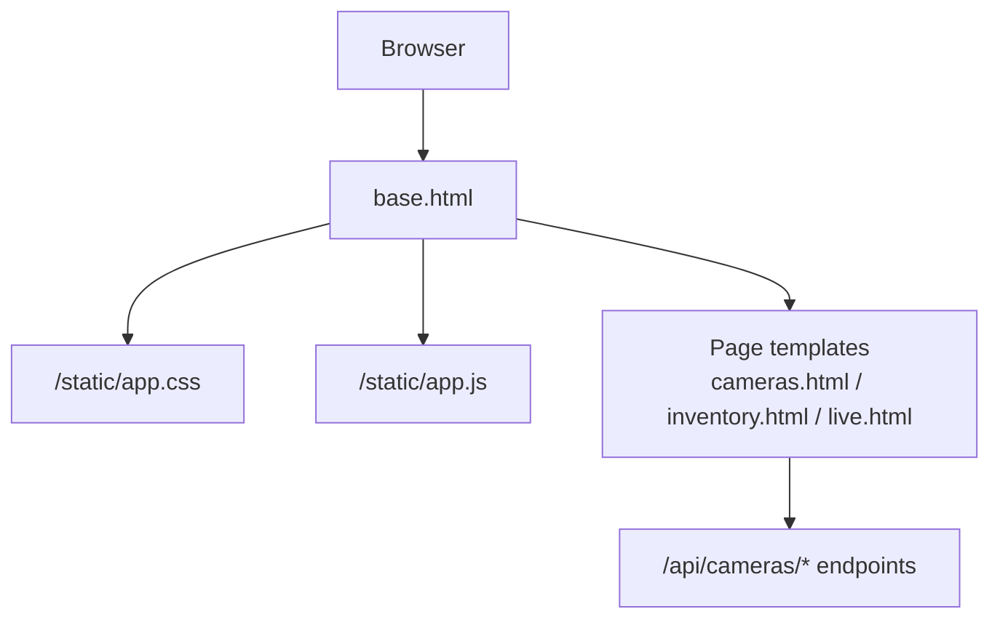
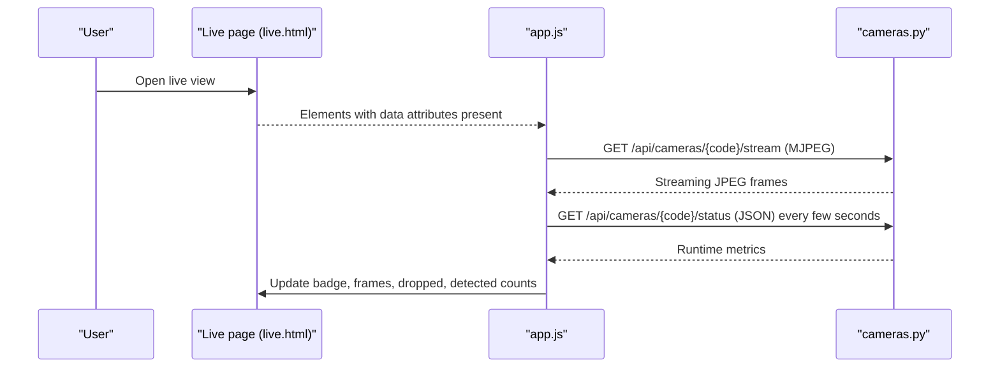
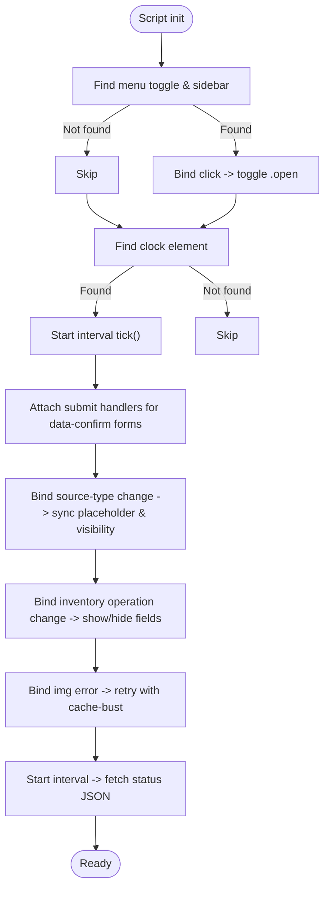
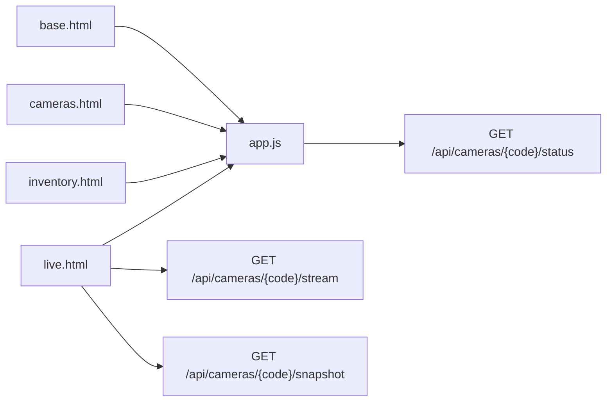

# Static Assets Management

<cite>
**Referenced Files in This Document**
- [app.js](file://app/ui/static/app.js)
- [app.css](file://app/ui/static/app.css)
- [base.html](file://app/ui/templates/base.html)
- [cameras.html](file://app/ui/templates/cameras.html)
- [inventory.html](file://app/ui/templates/inventory.html)
- [live.html](file://app/ui/templates/live.html)
- [cameras.py](file://app/api/cameras.py)
</cite>

## Table of Contents
1. [Introduction](#introduction)
2. [Project Structure](#project-structure)
3. [Core Components](#core-components)
4. [Architecture Overview](#architecture-overview)
5. [Detailed Component Analysis](#detailed-component-analysis)
6. [Dependency Analysis](#dependency-analysis)
7. [Performance Considerations](#performance-considerations)
8. [Troubleshooting Guide](#troubleshooting-guide)
9. [Conclusion](#conclusion)
10. [Appendices](#appendices)

## Introduction
This document explains how static assets are organized and used in the application, focusing on client-side JavaScript interactivity and CSS styling architecture. It covers menu toggling, live clock updates, form handling, camera stream behavior, status polling, inventory UI logic, asset loading strategies, caching considerations, performance optimization techniques, cross-browser compatibility, and accessibility guidance. The goal is to help developers add new interactive features, customize visual appearance consistently, and maintain reliable, accessible user interfaces.

## Project Structure
Static assets are served under a standard static path and included through the base template:
- Client script: `/static/app.js`
- Stylesheet: `/static/app.css`
- Base layout includes both assets and provides data attributes that drive client behavior.

**Diagram sources**
- [base.html:8-102](file://app/ui/templates/base.html#L8-L102)
- [cameras.py:290-328](file://app/api/cameras.py#L290-L328)

**Section sources**
- [base.html:8-102](file://app/ui/templates/base.html#L8-L102)

## Core Components
- app.js: Lightweight client-side behaviors attached via data attributes and class toggles.
- app.css: Centralized design system with CSS variables, layout primitives, component styles, and utility classes.
- base.html: Layout shell that wires the sidebar toggle button, live clock element, and includes static assets.
- cameras.html: Camera configuration forms using source-type-driven fields and confirmation prompts.
- inventory.html: Inventory operations with conditional field visibility based on operation type.
- live.html: Live MJPEG stream image and status card updated by client-side polling.
- cameras.py: Backend endpoints for stream, snapshot, and status JSON consumed by the client.

Key responsibilities:
- Menu toggling: Sidebar open/close controlled by a click handler on a menu toggle button.
- Clock updates: A periodic timer updates a timestamp element.
- Form handling: Confirmation dialogs, dynamic placeholder text, and conditional field display.
- Stream resilience: Automatic reconnection attempts when an MJPEG image fails to load.
- Status polling: Periodic fetch calls to update camera runtime metrics.

**Section sources**
- [app.js:8-133](file://app/ui/static/app.js#L8-L133)
- [base.html:79-102](file://app/ui/templates/base.html#L79-L102)
- [cameras.html:160-175](file://app/ui/templates/cameras.html#L160-L175)
- [inventory.html:84-125](file://app/ui/templates/inventory.html#L84-L125)
- [live.html:25-118](file://app/ui/templates/live.html#L25-L118)
- [cameras.py:290-328](file://app/api/cameras.py#L290-L328)

## Architecture Overview
The frontend uses a simple attribute-driven pattern:
- HTML elements expose behavior through data attributes (for example, `data-menu-toggle`, `data-clock`, `data-source-type`, `data-stream`, `data-camera-status`).
- app.js queries these elements once at startup and attaches event listeners or timers.
- The live page embeds an MJPEG stream image whose src points to a streaming endpoint; errors trigger automatic retry with a cache-busting query parameter.
- Status cards periodically poll a JSON endpoint to refresh badges and counters.

**Diagram sources**
- [live.html:25-118](file://app/ui/templates/live.html#L25-L118)
- [app.js:73-115](file://app/ui/static/app.js#L73-L115)
- [cameras.py:290-328](file://app/api/cameras.py#L290-L328)

## Detailed Component Analysis

### Client-Side Interactivity (app.js)
Behavior is implemented as small, isolated modules selected by data attributes:

- Mobile sidebar toggle
  - Trigger: Click on element with `data-menu-toggle`.
  - Action: Toggle `.open` class on `.sidebar`.
  - Integration: Button provided in base.html topbar.

- Live clock
  - Target: Element with `data-clock`.
  - Action: Update text content every second using localized time formatting.

- Confirmation dialogs
  - Target: Forms with `data-confirm`.
  - Action: Prompt before submit; cancel if user declines.

- Camera source field synchronization
  - Triggers: Change on select with `data-source-type`.
  - Actions:
    - Hide/show related input row based on source type.
    - Set contextual placeholder text per source type.

- Inventory operation field visibility
  - Triggers: Change on select with `data-inventory-operation`.
  - Actions: Show/hide delta, quantity, and location fields depending on operation value.

- Live stream error recovery
  - Target: Images with `data-stream`.
  - Action: On error, wait a few seconds and reload the stream URL with a timestamp query parameter to bypass caches.

- Status card polling
  - Target: Cards with `data-camera-status`.
  - Action: Every few seconds, fetch JSON from `/api/cameras/{code}/status` and update:
    - Badge label and state class.
    - Frames captured, frames dropped, and tracked objects count.

**Diagram sources**
- [app.js:8-133](file://app/ui/static/app.js#L8-L133)

**Section sources**
- [app.js:8-133](file://app/ui/static/app.js#L8-L133)
- [base.html:79-102](file://app/ui/templates/base.html#L79-L102)
- [cameras.html:160-175](file://app/ui/templates/cameras.html#L160-L175)
- [inventory.html:84-125](file://app/ui/templates/inventory.html#L84-L125)
- [live.html:25-118](file://app/ui/templates/live.html#L25-L118)

### Styling Architecture (app.css)
The stylesheet defines a cohesive design system:

- CSS variables
  - Colors for backgrounds, panels, borders, text, accents, semantic states (ok/warn/bad/info), muted tones, radius, and shadow.
  - Variables enable consistent theming across components and utilities.

- Global resets and typography
  - Box-sizing reset.
  - Body font stack, base size, line-height, link color, heading scale, code style.

- Layout primitives
  - `.layout`: Flex-based two-column layout with sticky sidebar.
  - `.sidebar`, `.nav`, `.brand`, `.topbar`, `.content`: Structural blocks for navigation and main content.

- Component styles
  - `.card`, `.kpi`, `.badge`, `.table-wrap`, `.photo-grid`, `.stream-box`, `.login-card`, `.error-page`.
  - These encapsulate common UI patterns such as dashboards, tables, photo grids, and login/error pages.

- Form controls
  - Inputs, selects, textareas, labels, checkboxes, help text, and field rows.
  - Focus states use accent colors and soft outlines for accessibility.

- Buttons and actions
  - `.btn` variants: primary, danger, ghost, small.
  - Button groups and inline forms.

- Utilities
  - Grid columns (`cols-2`, `cols-3`, `cols-4`), spacing helpers, monospace text, muted text, nowrap, bar charts, details summary, separators.

Responsive design patterns:
- Flexible grid layouts using `auto-fit` and `minmax` for adaptive column counts.
- Sticky topbar and sidebar for persistent navigation.
- Fluid typography and spacing suitable for various screen sizes.

Accessibility considerations:
- Semantic HTML structure supported by base template.
- Focus-visible-like outline for inputs/selects/textarea.
- Color-coded badges and notices should be supplemented with text labels or icons where needed.

Customization guidelines:
- Override CSS variables in `:root` to adjust theme colors, radii, and shadows.
- Use existing component classes rather than writing ad-hoc styles.
- Extend utility classes for minor adjustments instead of duplicating component rules.

**Section sources**
- [app.css:3-25](file://app/ui/static/app.css#L3-L25)
- [app.css:27-43](file://app/ui/static/app.css#L27-L43)
- [app.css:87-227](file://app/ui/static/app.css#L87-L227)
- [app.css:256-377](file://app/ui/static/app.css#L256-L377)
- [app.css:379-440](file://app/ui/static/app.css#L379-L440)
- [app.css:442-572](file://app/ui/static/app.css#L442-L572)
- [app.css:574-758](file://app/ui/static/app.css#L574-L758)
- [app.css:760-801](file://app/ui/static/app.css#L760-L801)

### Asset Loading Strategies and Caching
- Static assets inclusion
  - Stylesheet and script are linked in base.html head and body respectively.
  - Paths are absolute under `/static`.

- Stream caching
  - MJPEG stream endpoint sets `Cache-Control: no-store` and disables proxy buffering headers to ensure fresh frames.
  - Client-side error handler appends a timestamp query parameter to force re-fetch after transient failures.

- Snapshot endpoint
  - Also returns images with `no-store` cache control.

- Status polling
  - Uses `fetch` with JSON accept header; default browser caching applies unless server responses include appropriate cache headers.

Recommendations:
- Keep stream endpoints uncached to avoid stale frames.
- For non-stream assets, consider versioned filenames or long-lived caching with cache busting during deployments.
- Avoid heavy synchronous work in intervals; debounce or throttle where possible.

**Section sources**
- [base.html:8-102](file://app/ui/templates/base.html#L8-L102)
- [app.js:73-115](file://app/ui/static/app.js#L73-L115)
- [cameras.py:290-328](file://app/api/cameras.py#L290-L328)

### Cross-Browser Compatibility
- Modern APIs used:
  - `querySelector`, `classList.toggle`, `setInterval`, `fetch`, `Date.toLocaleTimeString`.
- Compatibility notes:
  - `fetch` requires modern browsers; polyfills may be needed for legacy environments.
  - `toLocaleTimeString` with locale options is widely supported but verify target locales.
  - CSS Grid and Flexbox are broadly supported; test older mobile browsers if required.
- Recommendations:
  - Add feature detection or polyfills for `fetch` if supporting older browsers.
  - Validate locale-specific time formatting across devices.
  - Ensure focus styles are visible on all platforms.

[No sources needed since this section provides general guidance]

### Accessibility Compliance
- Keyboard and focus:
  - Inputs and buttons have native focus behavior; custom focus styles improve visibility.
  - Sidebar toggle is a button element, ensuring keyboard operability.
- Semantics:
  - Use of `<button>` for interactions and proper form labeling supports assistive technologies.
- Color and contrast:
  - Semantic badges and notices rely on color; supplement with text or icons for clarity.
- Screen readers:
  - Provide meaningful alt text for stream images and descriptive labels for dynamic content updates.

Guidelines:
- Ensure all interactive elements have accessible names and roles.
- Announce dynamic updates (for example, status changes) to screen readers when appropriate.
- Maintain sufficient color contrast for badges and notices.

**Section sources**
- [base.html:79-102](file://app/ui/templates/base.html#L79-L102)
- [app.css:442-572](file://app/ui/static/app.css#L442-L572)

## Dependency Analysis
Client-side dependencies between templates and scripts:
- base.html provides structural hooks:
  - `data-menu-toggle` drives sidebar toggle.
  - `data-clock` drives live clock.
- cameras.html:
  - Uses `data-source-type` and `data-source-input` to synchronize source fields.
  - Uses `data-confirm` for destructive actions.
- inventory.html:
  - Uses `data-inventory-operation` to conditionally show/hide fields.
- live.html:
  - Uses `data-stream` for MJPEG image and `data-camera-status` for status polling.

Backend integration:
- live.html requests MJPEG stream and snapshot from `/api/cameras/{code}/stream` and `/api/cameras/{code}/snapshot`.
- app.js polls `/api/cameras/{code}/status` for runtime metrics.

**Diagram sources**
- [base.html:79-102](file://app/ui/templates/base.html#L79-L102)
- [cameras.html:160-175](file://app/ui/templates/cameras.html#L160-L175)
- [inventory.html:84-125](file://app/ui/templates/inventory.html#L84-L125)
- [live.html:25-118](file://app/ui/templates/live.html#L25-L118)
- [app.js:73-115](file://app/ui/static/app.js#L73-L115)
- [cameras.py:290-328](file://app/api/cameras.py#L290-L328)

**Section sources**
- [base.html:79-102](file://app/ui/templates/base.html#L79-L102)
- [cameras.html:160-175](file://app/ui/templates/cameras.html#L160-L175)
- [inventory.html:84-125](file://app/ui/templates/inventory.html#L84-L125)
- [live.html:25-118](file://app/ui/templates/live.html#L25-L118)
- [app.js:73-115](file://app/ui/static/app.js#L73-L115)
- [cameras.py:290-328](file://app/api/cameras.py#L290-L328)

## Performance Considerations
- Interval management:
  - Clock updates run every second; acceptable for lightweight DOM text updates.
  - Status polling runs every few seconds; ensure backend status endpoint is efficient.
- Stream handling:
  - MJPEG streams are inherently bandwidth-heavy; avoid unnecessary concurrent streams.
  - Error retry adds a delay to prevent rapid reconnection loops.
- CSS efficiency:
  - Prefer CSS variables and utility classes to reduce duplication.
  - Avoid excessive box-shadows or large gradients on frequently updated elements.
- Network:
  - Use `no-store` for streams and snapshots to prevent stale content.
  - Consider CDN caching for static assets with versioned filenames.

[No sources needed since this section provides general guidance]

## Troubleshooting Guide
Common issues and resolutions:
- Sidebar does not toggle:
  - Verify presence of `data-menu-toggle` button and `.sidebar` element in base.html.
  - Check console for JavaScript errors preventing initialization.

- Clock not updating:
  - Ensure element with `data-clock` exists in the topbar.
  - Confirm browser supports `toLocaleTimeString` with locale options.

- Source field placeholders not changing:
  - Confirm select has `data-source-type` and input has `data-source-input`.
  - Inspect form markup to ensure correct attribute names.

- Inventory fields not showing/hiding:
  - Ensure operation select has `data-inventory-operation`.
  - Verify child fields have correct `data-field-*` attributes.

- Live stream not loading:
  - Check network tab for 4xx/5xx errors on `/api/cameras/{code}/stream`.
  - Confirm backend stream endpoint returns MJPEG frames.
  - Inspect error handler retries adding timestamp query parameter.

- Status card not updating:
  - Verify card has `data-camera-status` with valid camera code.
  - Confirm `/api/cameras/{code}/status` returns expected JSON shape.
  - Check browser console for fetch errors.

**Section sources**
- [app.js:8-133](file://app/ui/static/app.js#L8-L133)
- [base.html:79-102](file://app/ui/templates/base.html#L79-L102)
- [cameras.html:160-175](file://app/ui/templates/cameras.html#L160-L175)
- [inventory.html:84-125](file://app/ui/templates/inventory.html#L84-L125)
- [live.html:25-118](file://app/ui/templates/live.html#L25-L118)
- [cameras.py:290-328](file://app/api/cameras.py#L290-L328)

## Conclusion
The static asset layer combines a minimal, attribute-driven JavaScript layer with a robust CSS design system. Client behaviors are decoupled from business logic, making it straightforward to extend functionality by adding new data attributes and corresponding handlers. The CSS architecture promotes consistency through variables and reusable components, while responsive patterns ensure usability across devices. By following the guidelines for asset loading, caching, performance, accessibility, and cross-browser compatibility, teams can maintain a reliable and user-friendly interface.

[No sources needed since this section summarizes without analyzing specific files]

## Appendices

### Adding New Interactive Features
Steps:
1. Identify the target element(s) and assign appropriate data attributes.
2. Extend app.js to bind events or timers for those attributes.
3. If backend interaction is needed, call the relevant API endpoint and update DOM elements accordingly.
4. Style new elements using existing component classes and utilities.
5. Test across devices and browsers; validate accessibility.

Example references:
- Menu toggle pattern: [app.js:8-14](file://app/ui/static/app.js#L8-L14), [base.html:79-88](file://app/ui/templates/base.html#L79-L88)
- Clock update pattern: [app.js:16-25](file://app/ui/static/app.js#L16-L25), [base.html:86-88](file://app/ui/templates/base.html#L86-L88)
- Form handling pattern: [app.js:27-34](file://app/ui/static/app.js#L27-L34), [cameras.html:58-67](file://app/ui/templates/cameras.html#L58-L67)
- Field synchronization pattern: [app.js:36-71](file://app/ui/static/app.js#L36-L71), [cameras.html:160-175](file://app/ui/templates/cameras.html#L160-L175), [inventory.html:84-125](file://app/ui/templates/inventory.html#L84-L125)
- Stream and status polling pattern: [app.js:73-115](file://app/ui/static/app.js#L73-L115), [live.html:25-118](file://app/ui/templates/live.html#L25-L118), [cameras.py:290-328](file://app/api/cameras.py#L290-L328)

### Customizing Visual Appearance
- Theme overrides:
  - Modify CSS variables in `:root` to adjust colors, radii, and shadows.
- Component usage:
  - Apply `.card`, `.kpi`, `.badge`, `.btn`, etc., to achieve consistent look and feel.
- Utilities:
  - Use grid variants, spacing helpers, and text utilities to compose layouts quickly.

References:
- Variables and global styles: [app.css:3-43](file://app/ui/static/app.css#L3-L43)
- Layout and components: [app.css:87-758](file://app/ui/static/app.css#L87-L758)