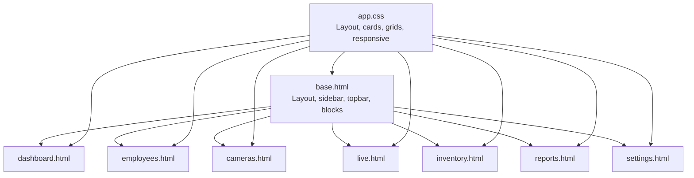
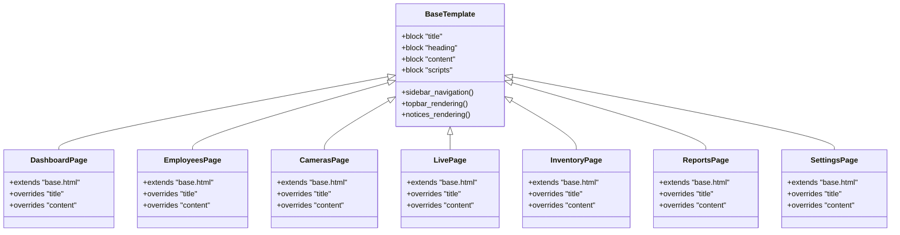
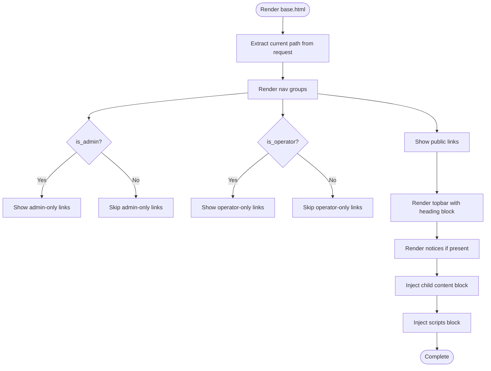
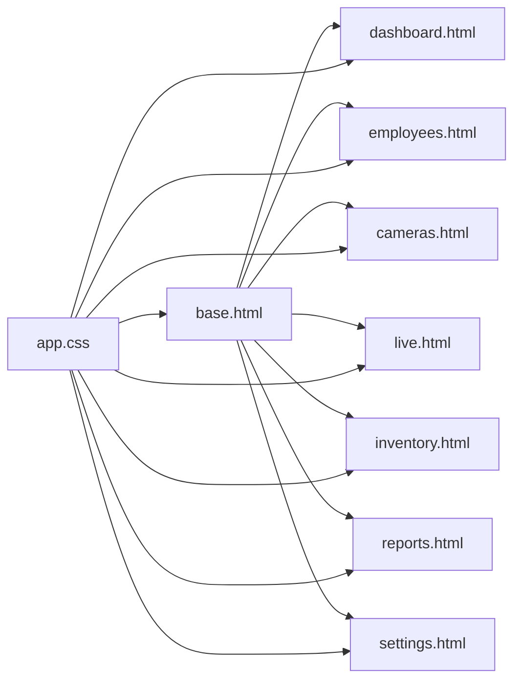

# Template Structure & Inheritance

<cite>
**Referenced Files in This Document**
- [base.html](file://app/ui/templates/base.html)
- [dashboard.html](file://app/ui/templates/dashboard.html)
- [employees.html](file://app/ui/templates/employees.html)
- [cameras.html](file://app/ui/templates/cameras.html)
- [live.html](file://app/ui/templates/live.html)
- [inventory.html](file://app/ui/templates/inventory.html)
- [reports.html](file://app/ui/templates/reports.html)
- [settings.html](file://app/ui/templates/settings.html)
- [app.css](file://app/ui/static/app.css)
</cite>

## Table of Contents
1. [Introduction](#introduction)
2. [Project Structure](#project-structure)
3. [Core Components](#core-components)
4. [Architecture Overview](#architecture-overview)
5. [Detailed Component Analysis](#detailed-component-analysis)
6. [Dependency Analysis](#dependency-analysis)
7. [Performance Considerations](#performance-considerations)
8. [Troubleshooting Guide](#troubleshooting-guide)
9. [Conclusion](#conclusion)

## Introduction
This document explains the Jinja2 template architecture used by the application. The base layout is defined in a single foundation template that provides the sidebar navigation, topbar, and content area. Child templates extend this base template and override specific blocks such as title, heading, and content to render page-specific UI.

The system uses role-based conditional rendering for navigation and actions. Variables like `is_admin` and `is_operator` control which menu items and features are visible. Dynamic data such as camera status, inventory balances, pending review counts, and user information are rendered through template variables and filters.

Responsive design is implemented with CSS classes and media queries. On smaller screens, the sidebar becomes a slide-out drawer controlled by a mobile menu toggle.

## Project Structure
The template layer lives under the UI package:
- Layout and shared structure: `app/ui/templates/base.html`
- Page templates: dashboard, employees, cameras, live, inventory, reports, settings
- Shared styles: `app/ui/static/app.css`

**Diagram sources**
- [base.html:1-106](file://app/ui/templates/base.html#L1-L106)
- [dashboard.html:1-188](file://app/ui/templates/dashboard.html#L1-L188)
- [employees.html:1-113](file://app/ui/templates/employees.html#L1-L113)
- [cameras.html:1-224](file://app/ui/templates/cameras.html#L1-L224)
- [live.html:1-158](file://app/ui/templates/live.html#L1-L158)
- [inventory.html:1-200](file://app/ui/templates/inventory.html#L1-L200)
- [reports.html:1-298](file://app/ui/templates/reports.html#L1-L298)
- [settings.html:1-242](file://app/ui/templates/settings.html#L1-L242)
- [app.css:87-227](file://app/ui/static/app.css#L87-L227)

**Section sources**
- [base.html:1-106](file://app/ui/templates/base.html#L1-L106)
- [app.css:87-227](file://app/ui/static/app.css#L87-L227)

## Core Components
- Foundation template: `base.html` defines the overall shell, including `<head>`, sidebar navigation, topbar, notices, and content block injection.
- Child templates: Each page extends `base.html` and overrides `title` and `content`. Some pages also customize the topbar heading via the `heading` block.
- Shared styles: `app.css` provides layout primitives (layout, sidebar, main, topbar, content), card and grid systems, badges, tables, forms, and responsive behavior.

Key responsibilities:
- `base.html`:
  - Sets document metadata and includes global CSS and JS.
  - Renders sidebar navigation with active-state logic based on the current URL path.
  - Applies role-based visibility for admin-only and operator-only sections.
  - Provides a topbar with dynamic date, clock placeholder, and optional simulation badge.
  - Injects notices and child content into the main area.
- Child templates:
  - Provide page titles and rich content using shared components like cards, grids, KPI tiles, tables, and forms.
  - Use template variables and filters to display business data.

**Section sources**
- [base.html:1-106](file://app/ui/templates/base.html#L1-L106)
- [app.css:87-227](file://app/ui/static/app.css#L87-L227)

## Architecture Overview
The template inheritance pattern follows a clear hierarchy:
- `base.html` is the root layout.
- Page templates extend `base.html` and fill in blocks.
- CSS classes provide consistent visual structure across all pages.

**Diagram sources**
- [base.html:1-106](file://app/ui/templates/base.html#L1-L106)
- [dashboard.html:1-188](file://app/ui/templates/dashboard.html#L1-L188)
- [employees.html:1-113](file://app/ui/templates/employees.html#L1-L113)
- [cameras.html:1-224](file://app/ui/templates/cameras.html#L1-L224)
- [live.html:1-158](file://app/ui/templates/live.html#L1-L158)
- [inventory.html:1-200](file://app/ui/templates/inventory.html#L1-L200)
- [reports.html:1-298](file://app/ui/templates/reports.html#L1-L298)
- [settings.html:1-242](file://app/ui/templates/settings.html#L1-L242)

## Detailed Component Analysis

### Base Template: Layout, Navigation, and Blocks
The base template establishes:
- Global document structure and favicon.
- Sidebar with grouped navigation links and active-state highlighting based on the request path.
- Role-based navigation:
  - Admin-only groups and links appear when `is_admin` is true.
  - Operator-only links appear when `is_operator` is true.
- Topbar with:
  - A mobile menu toggle button.
  - A heading block that defaults to the page title but can be overridden.
  - Optional simulation mode badge and date/time controls.
- Content area with:
  - Notices loop for warning/info/error messages.
  - Main content block where child templates inject their markup.
- Footer scripts block for page-specific JavaScript.

Role-based navigation highlights:
- Admin-only sections include employee management, equipment management, camera configuration, and settings.
- Operator-only section includes a review queue with a pending count badge when available.

Variables used in the base template:
- `request.url.path` for active link detection.
- `app_name` for default page title.
- `user.full_name`, `user.username`, `user.role_enum.label_uz` for user identity and role label.
- `csrf_token` for secure form submissions.
- `settings.simulation_mode` for simulation indicator.
- `today` for formatted date.
- `pending_total` for pending review count.

**Diagram sources**
- [base.html:1-106](file://app/ui/templates/base.html#L1-L106)

**Section sources**
- [base.html:1-106](file://app/ui/templates/base.html#L1-L106)

### Dashboard Template: KPIs, Camera Status, and System Health
The dashboard extends the base template and focuses on:
- KPI tiles for daily entries/exits, unknown persons, equipment movement, and pending reviews.
- Camera overview table showing online/offline status, frame counts, and last frame timestamps.
- Inventory alerts summary.
- System health indicators for monitoring, YOLO detector, face gallery, InsightFace, Google Sheets sync, and active employees.
- Recent events list with type labels and timestamps.

Conditional elements:
- Admin-only buttons for camera configuration.
- Badge styling depends on camera status values.
- Simulation mode affects stream behavior elsewhere; dashboard reflects system readiness.

Template variables and filters:
- `stats.entries`, `stats.exits`, `stats.unknown_persons`, `stats.equipment_in`, `stats.equipment_out`
- `pending_total`
- `cameras`, `online_cameras`, `total_cameras`
- `monitor_started`, `yolo.available`, `face.gallery_embeddings`, `face.available`, `sheets.configured`, `pending_sync`, `employees`
- `recent_events` with `event.type_label_uz`, `event.employee_label`, `event.equipment_category`, `event.occurred_at | local_dt`

**Section sources**
- [dashboard.html:1-188](file://app/ui/templates/dashboard.html#L1-L188)

### Employees Template: List, Filters, and Registration Form
The employees template extends the base template and provides:
- A notice about face recognition model availability.
- An employee list table with code, name, department, reference count, status, and registration timestamp.
- Search and filter form for querying employees.
- A registration form with fields for personal details, department, ID number, code, and notes.

Conditional elements:
- Face recognition unavailability notice.
- Empty state guidance to add new employees.

Template variables and filters:
- `face_status.available`, `face_status.reason`
- `employees`, `query`, `active_filter`
- `employee.employee_code`, `employee.full_name`, `employee.department`, `employee.reference_count`, `employee.is_active`, `employee.registered_at | local_short`
- `next_code`

**Section sources**
- [employees.html:1-113](file://app/ui/templates/employees.html#L1-L113)

### Cameras Template: Configuration, Actions, and Source Types
The cameras template extends the base template and provides:
- A table listing configured cameras with code, name/location, source type, line coordinates, status, frame count, and actions.
- Inline forms to toggle enablement, delete, and update camera settings.
- A collapsible configuration form per row.
- A separate form to add a new camera with validation hints and help text.

Conditional elements:
- Line coordinate display only when a line is configured.
- Disabled camera indicator.
- Confirmation prompts for destructive actions.

Template variables and filters:
- `rows`, `row.camera.code`, `row.camera.name`, `row.camera.location`, `row.camera.source_type`, `row.camera.masked_source`, `row.camera.has_line`, `row.camera.line_x1`, `row.camera.line_y1`, `row.camera.line_x2`, `row.camera.line_y2`, `row.camera.confidence_override`, `row.camera.settings.flip_line`, `row.camera.is_enabled`
- `row.status.value`, `row.status.label_uz`, `row.message`, `row.frames`
- `source_labels` mapping for human-readable source types

**Section sources**
- [cameras.html:1-224](file://app/ui/templates/cameras.html#L1-L224)

### Live Template: Stream Selection, Status Panel, and Recent Events
The live template extends the base template and provides:
- Camera selection buttons.
- MJPEG stream viewer with overlay indicating live or down status.
- Status panel showing connection state, frames received, dropped frames, last frame time, pipeline metrics, and processing errors.
- Recent events list filtered by selected camera.
- A full camera table for quick access.

Conditional elements:
- Admin-only link to add cameras when none exist.
- Pipeline metrics shown only when pipeline data is available.

Template variables and filters:
- `cameras`, `selected_code`, `selected_row.running`, `selected_row.status.label_uz`, `selected_row.frames`, `selected_row.dropped`, `selected_row.last_frame | local_short`, `selected_row.pipeline.tracks`, `selected_row.pipeline.frames_processed`, `selected_row.pipeline.events_created`, `selected_row.pipeline.processing_errors`
- `recent_events` with `event.type_label_uz`, `event.employee_label`, `event.occurred_at | local_dt`
- `rows` for full camera list

**Section sources**
- [live.html:1-158](file://app/ui/templates/live.html#L1-L158)

### Inventory Template: Balances, Manual Operations, and Journal
The inventory template extends the base template and provides:
- KPI tiles for pending inbound/outbound, category count, and discrepancy count.
- Category-wise balance table with initial, expected, pending inbound/outbound, projected, registered assets, and discrepancy.
- Manual operation form for operators, with conditional initial balance option for admins.
- Inventory journal table with transaction type, quantity, source, status, and reason.

Conditional elements:
- Operator-only manual operations.
- Admin-only initial balance operation.
- Status badges reflecting confirmation and rejection states.

Template variables and filters:
- `pending_total.pending_in`, `pending_total.pending_out`
- `balances`, `item.label_uz`, `item.category_code`, `item.initial`, `item.expected`, `item.pending_in`, `item.pending_out`, `item.projected`, `item.registered_assets`, `item.discrepancy`, `item.has_issue`
- `categories`
- `TransactionType(row.transaction_type).label_uz`
- `ledger` with `row.created_at | local_dt`, `row.source`, `row.is_confirmed`, `row.is_rejected`, `row.reason`, `row.location_to`

**Section sources**
- [inventory.html:1-200](file://app/ui/templates/inventory.html#L1-L200)

### Reports Template: Filters, Charts, Inventory Summary, and Sync Controls
The reports template extends the base template and provides:
- Filter form for date range, camera, event type, category, status, and employee.
- Bar charts for event types, verification status, and equipment categories.
- Top active employees list.
- Inventory summary table mirroring balances and discrepancies.
- Google Sheets integration status and manual sync button for operators.
- Event preview table limited to first 200 rows.

Conditional elements:
- Operator-only sync button.
- Conditional badges for sync status and event verification.

Template variables and filters:
- `filters.get('start')`, `filters.get('end')`, `filters.get('camera')`, `filters.get('type')`, `filters.get('category')`, `filters.get('status')`, `filters.get('employee_id')`
- `event_total`
- `by_type`, `by_status`, `by_category`, `by_employee`
- `balances`
- `sheets.configured`, `sheets.enabled`, `sheets.interval_seconds`, `sheets.last_result`, `sheets.spreadsheet_id`, `unsynced`
- `sync_logs` with `log.started_at | local_dt`, `log.status`, `log.pushed`, `log.failed`, `log.triggered_by`, `log.message`
- `events` with `event.occurred_at | local_dt`, `event.type_label_uz`, `event.employee_label`, `event.equipment_category`, `event.direction_label_uz`, `event.verification_status`, `event.status_label_uz`

**Section sources**
- [reports.html:1-298](file://app/ui/templates/reports.html#L1-L298)

### Settings Template: Model Status, Configuration, Users, Audit, and System Info
The settings template extends the base template and provides:
- Model status panels for YOLO, InsightFace, and monitoring, with reload controls.
- Configuration form grouped by feature areas, supporting boolean, integer, float, and text fields.
- User management table with password reset, activation toggling, and new user creation.
- Audit log table showing recent actions.
- System information panel displaying environment, timezone, database URL, directories, retention policy, and log directory.

Conditional elements:
- Warnings banner when configuration issues exist.
- Help text for unavailable models.
- Conditional options for roles and sensitive fields.

Template variables and filters:
- `warnings`
- `yolo.available`, `yolo.model_path`, `yolo.device`, `yolo.image_size`, `yolo.confidence`, `yolo.inference_count`, `yolo.last_inference_ms`, `yolo.using_fallback`, `yolo.reason`
- `face.available`, `face.model`, `face.providers`, `face.threshold`, `face.margin`, `face.gallery_embeddings`, `face.reason`
- `monitor_started`
- `sheets.configured`, `sheets.enabled`, `sheets.last_run_at`
- `env_path`
- `fields_by_group`, `values`, `field.kind`, `field.key`, `field.label_uz`, `field.help_uz`, `field.minimum`, `field.maximum`
- `users`, `item.username`, `item.full_name`, `item.role`, `item.role_enum.label_uz`, `item.is_active`, `item.last_login_at | local_short`, `item.id`, `user.id`
- `audit` with `row.occurred_at | local_dt`, `row.username`, `row.action`, `row.entity`, `row.entity_id`, `row.reason`
- `settings.env`, `settings.timezone`, `settings.database_url`, `settings.data_dir`, `settings.evidence_dir`, `settings.evidence_retention_days`, `settings.log_dir`
- `workplace_tz`

**Section sources**
- [settings.html:1-242](file://app/ui/templates/settings.html#L1-L242)

## Dependency Analysis
Template dependencies and relationships:
- All page templates depend on `base.html` for layout and shared components.
- Shared CSS classes are used consistently across templates to maintain visual coherence.
- Role-based variables (`is_admin`, `is_operator`) influence both navigation and page-level UI.

**Diagram sources**
- [base.html:1-106](file://app/ui/templates/base.html#L1-L106)
- [dashboard.html:1-188](file://app/ui/templates/dashboard.html#L1-L188)
- [employees.html:1-113](file://app/ui/templates/employees.html#L1-L113)
- [cameras.html:1-224](file://app/ui/templates/cameras.html#L1-L224)
- [live.html:1-158](file://app/ui/templates/live.html#L1-L158)
- [inventory.html:1-200](file://app/ui/templates/inventory.html#L1-L200)
- [reports.html:1-298](file://app/ui/templates/reports.html#L1-L298)
- [settings.html:1-242](file://app/ui/templates/settings.html#L1-L242)
- [app.css:87-227](file://app/ui/static/app.css#L87-L227)

**Section sources**
- [base.html:1-106](file://app/ui/templates/base.html#L1-L106)
- [app.css:87-227](file://app/ui/static/app.css#L87-L227)

## Performance Considerations
- Template rendering performance benefits from minimal complex logic inside templates. Business calculations should remain in backend services.
- Avoid heavy computations in loops; precompute aggregates like `pending_total`, `balances`, and chart data before passing to templates.
- Use pagination or limits for large datasets (e.g., limiting event previews to 200 rows).
- Keep CSS modular and reuse classes to reduce duplication and improve maintainability.
- Defer non-critical JavaScript to page-specific script blocks to avoid unnecessary overhead on every page.

[No sources needed since this section provides general guidance]

## Troubleshooting Guide
Common template-related issues and resolutions:
- Missing variables: Ensure the route handler passes required variables like `is_admin`, `is_operator`, `user`, `settings`, and page-specific data structures.
- Active link highlighting not working: Verify that `request.url.path` matches the expected routes and that anchor hrefs align with those paths.
- Role-based sections not appearing: Confirm that `is_admin` and `is_operator` flags are correctly set based on the authenticated user’s role.
- Notices not displayed: Check that the `notices` list is populated and each item has a `level` and `message`.
- Mobile menu not opening: Ensure the CSS class `.open` is toggled on the sidebar and the menu toggle button exists in the topbar.
- Forms failing CSRF validation: Confirm that `csrf_token` is included in hidden inputs for all POST forms.

**Section sources**
- [base.html:1-106](file://app/ui/templates/base.html#L1-L106)
- [app.css:807-837](file://app/ui/static/app.css#L807-L837)

## Conclusion
The Jinja2 template system in this project follows a clean inheritance pattern centered around a robust base layout. Child templates focus on domain-specific content while reusing shared components and styles. Role-based conditional rendering ensures appropriate access to features, and responsive CSS guarantees usability across devices. By adhering to these patterns, developers can extend the UI consistently and maintain a coherent user experience.

[No sources needed since this section summarizes without analyzing specific files]