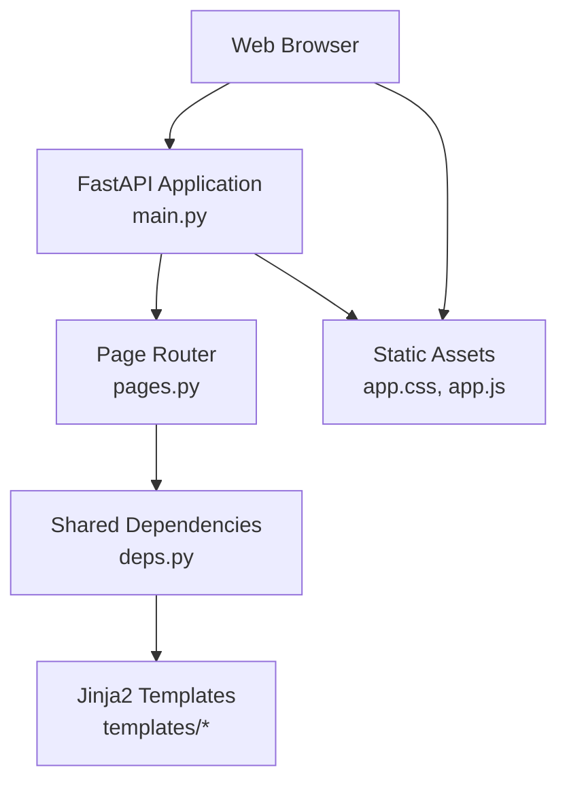
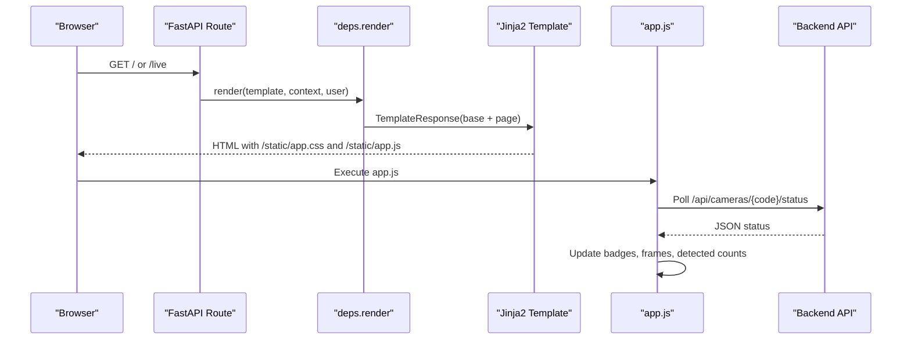
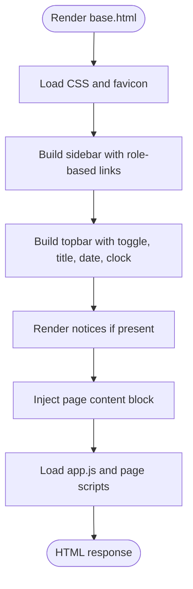
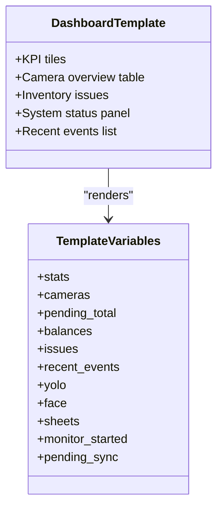
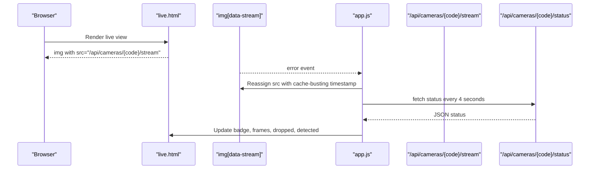
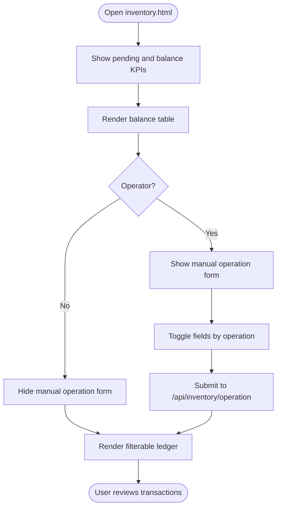
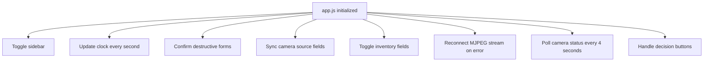
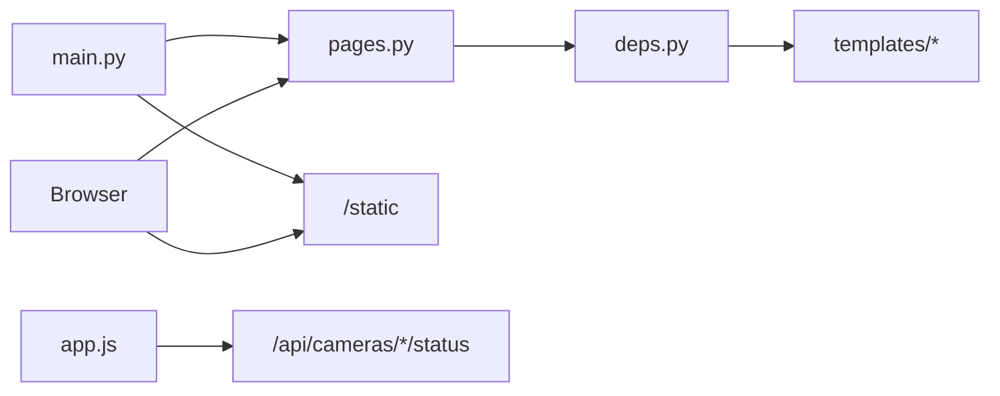

# UI & Frontend Architecture

<cite>
**Referenced Files in This Document**   
- [base.html](file://app/ui/templates/base.html)
- [dashboard.html](file://app/ui/templates/dashboard.html)
- [live.html](file://app/ui/templates/live.html)
- [inventory.html](file://app/ui/templates/inventory.html)
- [employees.html](file://app/ui/templates/employees.html)
- [equipment.html](file://app/ui/templates/equipment.html)
- [cameras.html](file://app/ui/templates/cameras.html)
- [settings.html](file://app/ui/templates/settings.html)
- [app.js](file://app/ui/static/app.js)
- [app.css](file://app/ui/static/app.css)
- [pages.py](file://app/api/pages.py)
- [deps.py](file://app/api/deps.py)
- [main.py](file://app/main.py)
</cite>

## Table of Contents
1. [Introduction](#introduction)
2. [Project Structure](#project-structure)
3. [Core Components](#core-components)
4. [Architecture Overview](#architecture-overview)
5. [Detailed Component Analysis](#detailed-component-analysis)
6. [Dependency Analysis](#dependency-analysis)
7. [Performance Considerations](#performance-considerations)
8. [Troubleshooting Guide](#troubleshooting-guide)
9. [Guidelines for Extending the UI](#guidelines-for-extending-the-ui)
10. [Conclusion](#conclusion)

## Introduction
This document explains the user interface and frontend architecture of the application. The UI is built with Jinja2 server-side templates, a single shared CSS file, and a small client-side JavaScript helper. It covers:

- Template organization and base template inheritance
- Page-specific templates for dashboard, live camera view, inventory management, employee management, equipment management, camera administration, and settings
- Static asset management through `app.js` and `app.css`
- Responsive design patterns, accessibility considerations, and cross-browser compatibility strategies
- Component composition patterns, template variable usage, and backend API integration
- Guidelines for adding new pages, customizing styles, and extending interactivity
- The relationship between server-rendered HTML and client-side enhancements

The system uses FastAPI to render Jinja2 templates and serve static assets under `/static`. User-facing pages are protected by session-based authentication and role checks, while interactive behaviors such as mobile sidebar toggling, live clock updates, form helpers, MJPEG stream error recovery, and periodic status polling are implemented in the browser.

## Project Structure
The UI layer lives under `app/ui`:

- `app/ui/templates/` contains Jinja2 templates.
- `app/ui/static/` contains `app.css` and `app.js`.
- FastAPI mounts `/static` and includes page routers that render templates via a shared dependency layer.

**Diagram sources**
- [main.py:44-68](file://app/main.py#L44-L68)
- [pages.py:25-78](file://app/api/pages.py#L25-L78)
- [deps.py:31-72](file://app/api/deps.py#L31-L72)

**Section sources**
- [main.py:44-68](file://app/main.py#L44-L68)
- [deps.py:31-72](file://app/api/deps.py#L31-L72)

## Core Components
The core frontend components are:

- **Base template**: Provides layout, navigation, topbar, notices, content block, global scripts, and common variables.
- **Page templates**: Extend the base template and fill title and content blocks with domain-specific data.
- **CSS**: Defines layout, cards, grids, tables, forms, badges, KPI tiles, stream boxes, login card, and responsive utilities.
- **JavaScript**: Implements lightweight client-side behavior without business logic.

Key responsibilities:

| Component | Responsibility |
|---|---|
| `base.html` | Layout shell, sidebar navigation, topbar, notice rendering, script injection, and shared template variables |
| `dashboard.html` | Dashboard KPIs, camera overview, inventory issues, system status, recent events |
| `live.html` | Camera selection, MJPEG stream display, selected camera status, recent events per camera |
| `inventory.html` | Inventory balances, pending counts, manual operations, ledger table, filters |
| `employees.html` | Employee list, search/filter, new employee form |
| `equipment.html` | Asset list, inline edit, category-to-YOLO mapping, new asset form |
| `cameras.html` | Camera list, toggle/delete, inline configuration, new camera form |
| `settings.html` | Model status, configuration editor, user management, audit log, system info |
| `app.js` | Mobile menu toggle, live clock, confirmation prompts, source field sync, inventory operation visibility, stream reconnect, status polling, decision buttons |
| `app.css` | Design tokens, layout, cards, grids, tables, forms, badges, stream overlay, login/error pages |

**Section sources**
- [base.html:1-106](file://app/ui/templates/base.html#L1-L106)
- [dashboard.html:1-188](file://app/ui/templates/dashboard.html#L1-L188)
- [live.html:1-158](file://app/ui/templates/live.html#L1-L158)
- [inventory.html:1-200](file://app/ui/templates/inventory.html#L1-L200)
- [employees.html:1-113](file://app/ui/templates/employees.html#L1-L113)
- [equipment.html:1-248](file://app/ui/templates/equipment.html#L1-L248)
- [cameras.html:1-224](file://app/ui/templates/cameras.html#L1-L224)
- [settings.html:1-242](file://app/ui/templates/settings.html#L1-L242)
- [app.js:1-134](file://app/ui/static/app.js#L1-L134)
- [app.css:1-837](file://app/ui/static/app.css#L1-L837)

## Architecture Overview
The UI follows a server-rendered template architecture with light client-side enhancement:

1. A FastAPI route renders a Jinja2 template using `deps.render`, which injects authenticated user context, CSRF token, notices, role flags, and time-related globals.
2. The base template provides the overall layout and loads `app.css` and `app.js`.
3. Page templates extend the base template and populate content blocks with data from services.
4. Client-side JavaScript enhances UX without replacing server-rendered content.

**Diagram sources**
- [pages.py:25-78](file://app/api/pages.py#L25-L78)
- [deps.py:136-160](file://app/api/deps.py#L136-L160)
- [app.js:83-115](file://app/ui/static/app.js#L83-L115)

**Section sources**
- [pages.py:25-78](file://app/api/pages.py#L25-L78)
- [deps.py:136-160](file://app/api/deps.py#L136-L160)
- [app.js:83-115](file://app/ui/static/app.js#L83-L115)

## Detailed Component Analysis

### Base Template and Layout Inheritance
The base template defines:

- Document language, viewport, favicon, and global stylesheet link.
- Sidebar navigation with conditional links based on roles (`is_admin`, `is_operator`).
- Topbar with menu toggle button, dynamic heading, simulation badge, date, and live clock element.
- Notice rendering loop for flash messages.
- Content block for page-specific markup.
- Global script injection and page-level script block extension.

Template variables commonly used across pages include:

| Variable | Meaning |
|---|---|
| `user` | Authenticated user object |
| `csrf_token` | CSRF token for POST forms |
| `notices` | Flash messages with level and message |
| `is_admin` | Boolean flag for admin access |
| `is_operator` | Boolean flag for operator/admin access |
| `settings` | Application settings object |
| `today` | Localized current date |
| `workplace_tz` | Workplace timezone string |

Accessibility and usability notes:

- The topbar menu toggle uses a `data-menu-toggle` attribute bound by `app.js`.
- Notices use semantic classes for success, warning, and error states.
- Forms include CSRF tokens and labels.
- The base template sets `lang="uz"`; if you add English-only pages, consider updating language attributes accordingly.

**Diagram sources**
- [base.html:1-106](file://app/ui/templates/base.html#L1-L106)

**Section sources**
- [base.html:1-106](file://app/ui/templates/base.html#L1-L106)
- [deps.py:136-160](file://app/api/deps.py#L136-L160)

### Dashboard Template
The dashboard template extends the base template and displays:

- KPI tiles for entries, exits, unknown persons, equipment movement, and pending review count.
- Camera overview table with status badges, frame counts, and last frame timestamps.
- Inventory issue summary with expected, pending out, and discrepancy indicators.
- System status panel showing monitoring, YOLO, face recognition, Google Sheets, pending sync queue, and active employees.
- Recent events list with type labels and localized timestamps.

Template variables include:

| Variable | Meaning |
|---|---|
| `stats` | Dashboard statistics |
| `cameras` | Camera rows with status and metrics |
| `total_cameras` | Total number of cameras |
| `online_cameras` | Number of online cameras |
| `pending_total` | Count of pending review events |
| `balances` | Category balances with issue flags |
| `issues` | Categories with discrepancies |
| `recent_events` | Recent event records |
| `yolo`, `face`, `sheets` | Service status objects |
| `monitor_started` | Monitoring service started flag |
| `pending_sync` | Pending synchronization count |

**Diagram sources**
- [dashboard.html:1-188](file://app/ui/templates/dashboard.html#L1-L188)

**Section sources**
- [dashboard.html:1-188](file://app/ui/templates/dashboard.html#L1-L188)

### Live Camera View Template
The live view template provides:

- Camera selector buttons.
- MJPEG stream image with overlay showing live indicator, camera code, and status label.
- Selected camera status card updated periodically by client-side JavaScript.
- Recent events for the selected camera.
- Full camera table with source type, line presence, status, frames, and last frame timestamp.

Client-side integration:

- The stream image uses `data-stream` and an `error` handler to reconnect after failures.
- Status elements use `data-camera-status`, `data-status-badge`, `data-frames`, `data-dropped`, and `data-detected` attributes for periodic updates.

**Diagram sources**
- [live.html:25-118](file://app/ui/templates/live.html#L25-L118)
- [app.js:73-115](file://app/ui/static/app.js#L73-L115)

**Section sources**
- [live.html:1-158](file://app/ui/templates/live.html#L1-L158)
- [app.js:73-115](file://app/ui/static/app.js#L73-L115)

### Inventory Management Template
The inventory template shows:

- Pending incoming and outgoing counts.
- Number of categories and categories with discrepancies.
- Balance table with initial, expected, pending in/out, projected, registered assets, and discrepancy.
- Manual operation form for operators with conditional fields for quantity, delta, and location.
- Filterable ledger table with transaction type, quantity sign, source badge, confirmation state, and reason/location.

Client-side behavior:

- Selecting an operation toggles visibility of delta, quantity, and location fields.
- Forms submit to `/api/inventory/operation` with CSRF token.

**Diagram sources**
- [inventory.html:1-200](file://app/ui/templates/inventory.html#L1-L200)
- [app.js:57-71](file://app/ui/static/app.js#L57-L71)

**Section sources**
- [inventory.html:1-200](file://app/ui/templates/inventory.html#L1-L200)
- [app.js:57-71](file://app/ui/static/app.js#L57-L71)

### Employee Management Template
The employee template provides:

- Warning notice when face recognition model is unavailable.
- Searchable and filterable employee list with reference count, status, and registration date.
- New employee form posting to `/api/employees`.

Template variables include:

| Variable | Meaning |
|---|---|
| `face_status` | Face recognition availability and reason |
| `employees` | Employee records |
| `query` | Current search query |
| `active_filter` | Active filter value |
| `next_code` | Suggested next employee code |

**Section sources**
- [employees.html:1-113](file://app/ui/templates/employees.html#L1-L113)

### Equipment Management Template
The equipment template provides:

- Searchable and filterable asset list with inline edit details.
- New asset form posting to `/api/equipment`.
- Category-to-YOLO class mapping table with inline configuration forms.

Template variables include:

| Variable | Meaning |
|---|---|
| `assets` | Asset records |
| `categories` | Category definitions |
| `statuses` | Equipment statuses |
| `selected_category` | Current category filter |
| `selected_status` | Current status filter |
| `counts` | Asset counts per category |
| `next_codes` | Suggested next codes per category |

**Section sources**
- [equipment.html:1-248](file://app/ui/templates/equipment.html#L1-L248)

### Camera Administration Template
The camera template provides:

- Camera list with masked source, virtual line coordinates, status, frame count, and actions.
- Inline toggle and delete forms with confirmation prompts.
- Inline configuration form for name, location, source type, source, line coordinates, confidence override, flip line, and enabled state.
- New camera form with validation hints and help text.

Client-side behavior:

- Source type changes update placeholder and hide/show source input.
- Confirmation prompts use `data-confirm`.

**Section sources**
- [cameras.html:1-224](file://app/ui/templates/cameras.html#L1-L224)
- [app.js:36-55](file://app/ui/static/app.js#L36-L55)

### Settings Template
The settings template provides:

- Warnings section.
- Model status controls for reloading YOLO model and refreshing face gallery.
- Configuration editor grouped by detection, camera, face, events, and Sheets.
- User management table with password reset and toggle forms.
- Audit log table.
- System information panel.

Template variables include:

| Variable | Meaning |
|---|---|
| `warnings` | Configuration warnings |
| `yolo`, `face` | Model status objects |
| `monitor_started` | Monitoring started flag |
| `sheets` | Sheets status object |
| `env_path` | Path to `.env` file |
| `fields_by_group` | Grouped editable fields |
| `values` | Current values for fields |
| `users` | User records |
| `audit` | Audit log records |
| `settings` | Application settings |

**Section sources**
- [settings.html:1-242](file://app/ui/templates/settings.html#L1-L242)

### Static Assets: CSS and JavaScript

#### CSS Architecture
`app.css` defines:

- Design tokens via CSS custom properties for background, panels, borders, text, accent, status colors, radius, and shadow.
- Layout using Flexbox and Grid for sidebar, main area, topbar, and content.
- Reusable components: cards, KPI tiles, badges, tables, forms, buttons, filters, stream box, photo grid, lists, stat lines, progress bars, details summaries, login card, and error page.
- Responsive patterns using `auto-fit` and `minmax` grid columns.

Accessibility and cross-browser considerations:

- Uses standard CSS features supported by modern browsers.
- Focus states are defined for inputs, selects, and textareas.
- Semantic classes like `notice.ok/warn/error` provide consistent visual feedback.
- Monospace font stack for numeric and code-like values improves readability.

**Section sources**
- [app.css:1-837](file://app/ui/static/app.css#L1-L837)

#### JavaScript Architecture
`app.js` implements:

- Mobile sidebar toggle via `data-menu-toggle`.
- Live clock updating every second using `toLocaleTimeString`.
- Form confirmation dialogs via `data-confirm`.
- Camera source field synchronization based on source type.
- Inventory operation field visibility toggling.
- MJPEG stream reconnection with cache-busting timestamp.
- Periodic status polling for camera status endpoints.
- Decision button behavior for approval/rejection flows.

Cross-browser strategy:

- Uses vanilla JavaScript without frameworks.
- Avoids advanced APIs where possible.
- Handles network errors gracefully by ignoring failures and retrying on next interval.

**Diagram sources**
- [app.js:1-134](file://app/ui/static/app.js#L1-L134)

**Section sources**
- [app.js:1-134](file://app/ui/static/app.js#L1-L134)

### Backend Integration Points
The frontend integrates with backend endpoints primarily through:

- Server-rendered templates that pass data from services.
- Client-side `fetch` calls to `/api/cameras/{code}/status`.
- Forms posting to API endpoints with CSRF tokens.

Examples:

- Dashboard and live view routes render templates with camera overviews, event stats, and service status.
- Inventory operations post to `/api/inventory/operation`.
- Employees and equipment forms post to their respective API endpoints.
- Camera configuration and lifecycle actions post to `/api/cameras/{id}/update`, `/toggle`, and `/delete`.
- Settings updates post to `/api/settings`.

**Section sources**
- [pages.py:25-78](file://app/api/pages.py#L25-L78)
- [inventory.html:81-127](file://app/ui/templates/inventory.html#L81-L127)
- [employees.html:75-111](file://app/ui/templates/employees.html#L75-L111)
- [equipment.html:57-110](file://app/ui/templates/equipment.html#L57-L110)
- [cameras.html:55-128](file://app/ui/templates/cameras.html#L55-L128)
- [settings.html:72-116](file://app/ui/templates/settings.html#L72-L116)

## Dependency Analysis
The frontend depends on:

- **FastAPI routing**: Page routes render templates and pass context.
- **Shared dependencies**: Authentication, authorization, CSRF, template globals, and rendering helper.
- **Static files**: CSS and JS served under `/static`.
- **API endpoints**: JSON endpoints polled by client-side JavaScript.

**Diagram sources**
- [main.py:44-68](file://app/main.py#L44-L68)
- [pages.py:25-78](file://app/api/pages.py#L25-L78)
- [deps.py:31-72](file://app/api/deps.py#L31-L72)
- [app.js:83-115](file://app/ui/static/app.js#L83-L115)

**Section sources**
- [main.py:44-68](file://app/main.py#L44-L68)
- [pages.py:25-78](file://app/api/pages.py#L25-L78)
- [deps.py:31-72](file://app/api/deps.py#L31-L72)
- [app.js:83-115](file://app/ui/static/app.js#L83-L115)

## Performance Considerations
- **Server-rendered templates**: Reduce client-side complexity and improve initial load performance.
- **MJPEG streams**: Use browser-native streaming; avoid heavy client-side processing.
- **Periodic polling**: Status polling runs every 4 seconds; adjust frequency if needed for high-load environments.
- **CSS reuse**: Shared styles minimize duplication and improve caching.
- **Minimal JavaScript**: Lightweight helpers reduce bundle size and execution overhead.

[No sources needed since this section provides general guidance]

## Troubleshooting Guide
Common UI-related issues and resolutions:

| Symptom | Cause | Resolution |
|---|---|---|
| Sidebar does not toggle on mobile | Missing `data-menu-toggle` or JS not loaded | Ensure base template loads `app.js` and toggle button has correct attribute |
| Live clock not updating | `data-clock` element missing or JS error | Verify clock element exists and no console errors |
| MJPEG stream stops | Network interruption or camera offline | `app.js` reconnects automatically; check camera status endpoint |
| Status badges not updating | Status polling fails or endpoint unavailable | Check `/api/cameras/{code}/status`; inspect network tab |
| Inventory fields do not show/hide | Operation select missing `data-inventory-operation` | Add attribute and ensure field selectors match |
| CSRF submission rejected | Token mismatch or expired session | Refresh page and resubmit; verify session configuration |
| Admin-only links missing | User role not admin | Log in as admin or adjust role assignment |

**Section sources**
- [app.js:7-34](file://app/ui/static/app.js#L7-L34)
- [app.js:73-115](file://app/ui/static/app.js#L73-L115)
- [deps.py:87-90](file://app/api/deps.py#L87-L90)

## Guidelines for Extending the UI

### Adding a New Page
1. Create a new template under `app/ui/templates/` that extends `base.html`.
2. Define `` and ``.
3. Add a route in the appropriate router module that calls `deps.render` with the template and context.
4. If the page requires admin or operator access, use `require_admin` or `require_operator` dependencies.
5. Add navigation links in `base.html` conditionally based on roles.
6. If the page needs client-side behavior, add handlers in `app.js` using attribute selectors.

Example pattern:

- Template: `New Page...`
- Route: Render template with `deps.render(request, "new_page.html", context, user=user)`
- Navigation: Add `<a href="/new-page" class="{{ 'active' if path.startswith('/new-page') else '' }}">...</a>` inside sidebar

**Section sources**
- [base.html:19-66](file://app/ui/templates/base.html#L19-L66)
- [deps.py:136-160](file://app/api/deps.py#L136-L160)

### Customizing Styles
- Prefer modifying CSS variables in `:root` for theme-wide changes.
- Use existing component classes like `card`, `kpi`, `badge`, `btn`, `grid`, `table-wrap`, and `field-row`.
- For new layouts, extend grid classes or create new utility classes following existing naming conventions.
- Keep responsive behavior consistent with `auto-fit` and `minmax` patterns.

**Section sources**
- [app.css:1-837](file://app/ui/static/app.css#L1-L837)

### Adding Interactive Features
- Use `data-*` attributes to bind behavior in `app.js`.
- Keep client-side logic minimal and focused on UI interactions.
- For AJAX updates, follow the pattern used for camera status polling: target elements by attributes and update DOM nodes safely.
- Handle errors gracefully and avoid blocking the main thread.

**Section sources**
- [app.js:1-134](file://app/ui/static/app.js#L1-L134)

### Template Variable Usage
- Pass only necessary data from routes to templates.
- Use enums exposed via `deps.render` globals for labels and formatting.
- Use localization helpers like `local_dt` and `local_short` for timestamps.
- Leverage role flags (`is_admin`, `is_operator`) to conditionally render sections.

**Section sources**
- [deps.py:51-68](file://app/api/deps.py#L51-L68)
- [deps.py:136-160](file://app/api/deps.py#L136-L160)

### Relationship Between Server Rendering and Client Enhancements
- Server renders complete HTML with data-bound placeholders.
- Client JavaScript enhances UX without replacing rendered content.
- For real-time data, prefer polling endpoints and updating specific DOM nodes rather than reloading pages.
- Maintain separation: templates handle structure and data presentation; JavaScript handles interaction and minor updates.

**Section sources**
- [pages.py:25-78](file://app/api/pages.py#L25-L78)
- [app.js:83-115](file://app/ui/static/app.js#L83-L115)

## Conclusion
The UI architecture combines server-rendered Jinja2 templates with a cohesive CSS system and lightweight JavaScript enhancements. Base template inheritance ensures consistent layout and navigation, while page-specific templates deliver domain functionality. Static assets are centralized and reusable. The design emphasizes clarity, responsiveness, and maintainability. Extending the UI involves creating templates, wiring routes, passing context, and optionally adding small client-side behaviors. This approach keeps the frontend simple, accessible, and closely integrated with backend services.

[No sources needed since this section summarizes without analyzing specific files]